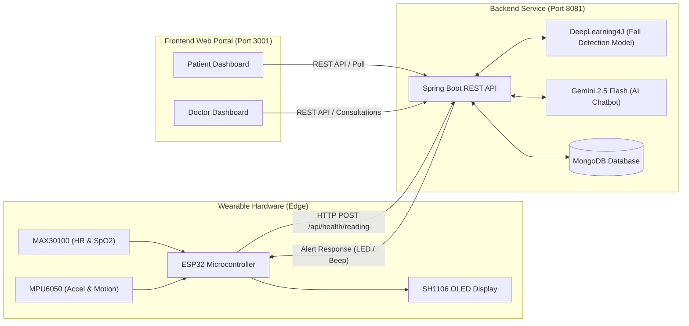

# 🩺 HealthWatch - Smart IoT Health Monitoring System

An end-to-end, IoT-enabled intelligent patient monitoring platform combining wearable edge sensors (**ESP32**, **MAX30100**, **MPU6050**), a high-performance **Spring Boot 3** backend, embedded **DeepLearning4J (DL4J)** neural network for fall detection, **MongoDB** for clinical telemetry storage, and a responsive **Web Dashboard** for patients and doctors.

---

## 🌟 Key Features

- **Real-Time IoT Telemetry**: Continuous streaming of Heart Rate (BPM), Blood Oxygen ($\text{SpO}_2$), Temperature, and Step Count via ESP32.
- **On-Device & AI Fall Detection**: Hybrid fall detection combining local accelerometer threshold tripwires with server-side DL4J neural network inference.
- **Bi-Directional Alerts**: Server-triggered critical vital alerts dispatched back to wearable display (OLED SH1106) and live web interfaces.
- **Patient Dashboard**: Real-time vitals monitoring, trend graphs (Chart.js), reading history, doctor consultation notes, and emergency SOS button.
- **Doctor Clinical Portal**: Multi-patient overview, critical alert triage, historical vital analysis, consultation note recording, and AI health risk assessment.
- **AI Health Assistant**: Integrated Google Gemini conversational assistant delivering context-aware health advisory based on recent vitals.
- **Dockerized Architecture**: One-command deployment using Docker Compose for database, backend, and frontend services.

---

## 🏗️ System Architecture



---

## 📁 Repository Structure

```text
├── backend/                       # Spring Boot 3 Java Backend
│   ├── src/main/java/             # Controllers, Services, Repositories, DTOs, DL4J model
│   ├── src/main/resources/        # application.properties & fall detection training dataset
│   ├── Dockerfile                 # Multi-stage JDK 21 build container
│   ├── pom.xml                    # Maven configuration
│   └── README.md                  # Backend API documentation
├── frontend/                      # Responsive Web Application
│   ├── css/                       # Modular UI stylesheets & themes
│   ├── js/                        # API client, auth, patient & doctor dashboard logic
│   ├── index.html                 # Main single-page interface
│   ├── Dockerfile                 # Lightweight container image
│   └── vercel.json                # Vercel deployment configuration
├── esp32/                         # Microcontroller Firmware
│   └── HealthWatchESP32/
│       ├── HealthWatchESP32.ino   # Arduino/ESP32 C++ firmware
│       └── README.md              # Wiring, libraries & sensor details
├── docker-compose.yml             # Full-stack Docker orchestration
├── .env.example                   # Environment variable template
├── .gitignore                     # Git ignore rules for clean commits
└── README.md                      # Project master documentation
```

---

## 🔌 Hardware Setup & Pinout

### Components Required
| Component | Function | Interface |
|---|---|---|
| **ESP32 / ESP32-C3** | Microcontroller & WiFi Client | - |
| **MAX30100** | Pulse Oximeter & Heart Rate Sensor | I2C (`0x57`) |
| **MPU6050** | 3-Axis Accelerometer & Gyroscope | I2C (`0x68`) |
| **SH1106** | 128x64 I2C OLED Display | I2C (`0x3C` or `0x3D`) |
| **LED / Buzzer** | Alert indicator | GPIO |

### Wiring (I2C Bus)
| Sensor / Peripheral Pin | ESP32-C3 Pin | ESP32 WROOM (Standard) |
|---|---|---|
| **SDA** (OLED, MPU6050, MAX30100) | `GPIO 8` | `GPIO 21` |
| **SCL** (OLED, MPU6050, MAX30100) | `GPIO 9` | `GPIO 22` |
| **Status LED** | `GPIO 10` | `GPIO 2` |
| **VCC** | `3.3V` | `3.3V` |
| **GND** | `GND` | `GND` |

---

## 🚀 Quick Start (Docker Compose)

The easiest way to start the entire system (MongoDB + Spring Boot Backend + Frontend Web Portal) is with Docker:

### 1. Clone the repository
```bash
git clone https://github.com/your-username/HealthWatch.git
cd HealthWatch
```

### 2. Configure Environment (Optional)
Copy `.env.example` to `.env` and add your Gemini API key if you want to enable the patient chatbot:
```bash
cp .env.example .env
```

### 3. Launch with Docker Compose
```bash
docker compose up --build
```

### 4. Access the Applications
- **Frontend Dashboard**: [http://localhost:3001](http://localhost:3001)
- **Backend REST API**: [http://localhost:8081](http://localhost:8081)
- **Health Check**: [http://localhost:8081/api/ping](http://localhost:8081/api/ping)
- **MongoDB**: `localhost:27017`

---

## 🔑 Demo Login Credentials

The application auto-seeds sample demo credentials upon startup:

| Role | User ID | Password | Access / Features |
|---|---|---|---|
| **Patient** | `patient1` | `miniproject` | View own vitals, graphs, history, SOS trigger, AI chatbot |
| **Doctor** | `doctor1` | `miniproject` | All-patient overview, active alerts, clinical consultation notes, AI analysis |

---

## 💻 Manual Setup & Development

### 1. Backend Service (Spring Boot)
**Prerequisites**: Java 21, Maven, MongoDB running locally on port 27017.

```bash
cd backend

# Run directly via Maven
./mvnw spring-boot:run
# On Windows:
.\mvnw.cmd spring-boot:run
```

### 2. Frontend Application
Open `frontend/index.html` directly in any modern web browser or serve via any static file server:
```bash
cd frontend
# Python HTTP server
python -m http.server 3001
```
*Note: When accessed via `localhost` or `127.0.0.1`, the frontend automatically connects to the backend at `http://localhost:8081`.*

### 3. ESP32 Firmware Flashing
1. Open `esp32/HealthWatchESP32/HealthWatchESP32.ino` in **Arduino IDE**.
2. Install required Arduino libraries:
   - `Adafruit MPU6050`
   - `Adafruit Unified Sensor`
   - `MAX30100lib` (by OXullo Interurban)
   - `U8g2`
3. Update WiFi credentials and Backend URL:
   ```cpp
   const char* WIFI_SSID     = "YOUR_WIFI_SSID";
   const char* WIFI_PASSWORD = "YOUR_WIFI_PASSWORD";
   const char* READING_URL   = "http://YOUR_LOCAL_IP:8081/api/health/reading";
   ```
4. Select your board (e.g. `ESP32C3 Dev Module` or `ESP32 Dev Module`) and click **Upload**.

---

## 📡 REST API Reference

### Health Telemetry Ingestion (ESP32)
`POST /api/health/reading`
```json
{
  "deviceId": "ESP32-DEMO01",
  "xAccel": 0.04,
  "yAccel": -0.02,
  "zAccel": 1.02,
  "heartRate": 78,
  "spo2": 98,
  "temperature": 36.7,
  "stepCount": 1420,
  "timestamp": "1730000000"
}
```

**Response Payload:**
```json
{
  "heartRateAlert": false,
  "spo2Alert": false,
  "fallAlert": false,
  "tempAlert": false,
  "anyAlert": false,
  "sendAlertToDevice": false,
  "severity": "OK",
  "aiRiskLevel": "NORMAL",
  "fallProbability": 0.031
}
```

### Other Key Endpoints
| Method | Endpoint | Description |
|---|---|---|
| `POST` | `/api/auth/login` | Authenticate patient or doctor |
| `GET` | `/api/dashboard/patient/{patientId}` | Retrieve patient summary, readings & active alerts |
| `GET` | `/api/dashboard/doctor/{doctorId}/overview` | Retrieve all assigned patients & vitals |
| `POST` | `/api/consultations` | Save clinical consultation notes |
| `POST` | `/api/sos` | Trigger emergency SOS |
| `POST` | `/api/chatbot/message` | Gemini AI vital-aware conversation |

---

## 🛡️ Security & Privacy Notice

- **No hardcoded secrets or credentials**: All MongoDB URIs, WiFi credentials, and API keys are externalized into environment variables (`.env`).
- **No private personal details**: Personal identity numbers and real identities have been replaced with anonymized demo records (`patient1`, `doctor1`).

---

## 📄 License
This project is open-source under the [MIT License](LICENSE).

